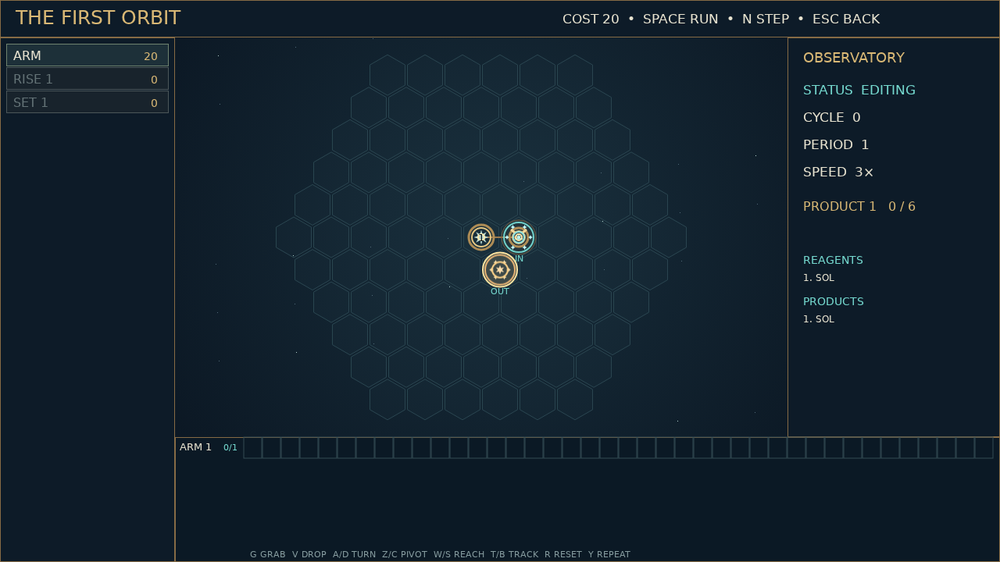

# Orrery

Set the heavens turning. Orrery is a puzzle game about designing a machine that handles tiny celestial constellations. Each challenge gives you a reagent pattern and a product pattern. A rise opens the sky to new motes; a set collects the finished work. Between them lies an empty hex field and a workshop full of moving parts. Your job is to decide where everything belongs.

Drag an arm onto the field and give it an instruction tape. A simple loop can grab a mote, swing it across the field, release it, and return for the next one. More intricate machines use tracks, pistons, wheels, and engraved sigils to bind, split, and transform constellations. Run the machine to watch every spoke and gripper follow its program. If motes collide or an instruction cannot be carried out, the machine stops at the fault so you can revise the design.

A challenge is complete when every requested product has reached its set six times. You can then keep tinkering with the same machine, or move on. Orrery remembers your best cost, cycle count, and area separately, so a solved puzzle is an invitation to find a more elegant orbit. The tape loops on a shared period, and a small change in timing can turn a sprawling construction into a precise little clock.

Campaign teaches the workshop through a sequence of celestial problems, while Extras opens a shelf of standalone challenges from the beginning. Both use the same sky and the same parts, so lessons learned in one can reshape your approach to the other. Build slowly, step one cycle at a time when you need to, then let the whole instrument run.

